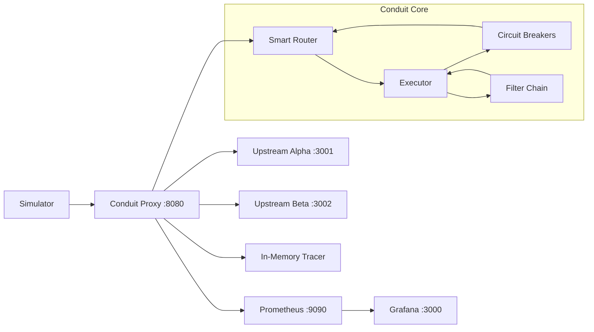

# Conduit


A minimal distributed systems lab for exploring adaptive routing, failure handling, and observability in Go.

Conduit is a self-healing HTTP proxy that routes traffic across multiple upstreams using latency-aware scoring, circuit breakers, and controlled exploration.

It simulates failures, latency spikes, and burst traffic while exposing Prometheus metrics and Grafana dashboards for real-time system visibility.

---

## Getting started

### One-command setup (recommended)

```bash
make up
```

### Local development (without Docker)

```bash
make dev
```

This starts the full stack:

- proxy (Conduit)
- upstream services (alpha, beta)
- simulator
- Prometheus
- Grafana

#### Access services

| Service  | URL |
| -------- | ------- |
| Proxy  | http://localhost:8080    |
| Upstream A | http://localhost:3001     |
| Upstream B    | http://localhost:3002    |
| Prometheus    | http://localhost:9090    |
| Grafana    | http://localhost:3000      |

Default Grafana login:

Username: admin  
Password: admin

---

## Why this exists

Modern distributed systems fail in non-obvious ways:

- latency increases before errors appear
- a “healthy” service can silently degrade
- naive load balancing amplifies failure domains
- reactive systems need feedback loops, not static rules

**Conduit is a controlled environment to observe, simulate, and reason about those behaviors.**

---

## Core ideas

- Adaptive routing based on EWMA latency + error rates
- Circuit breakers to isolate unhealthy upstreams
- Epsilon-based exploration to avoid local optima
- Replayable load simulation with burst and failure injection
- Full Prometheus-native observability (no custom metric pipelines or aggregations)

---

## System at a glance

Traffic flows through a decision layer that continuously balances:

- performance (latency)
- reliability (error rate)
- resilience (breaker state)
- exploration (randomized sampling)

Everything is observable in real time via Prometheus and Grafana.

---

## Observability

All metrics are exposed in Prometheus format at `/metrics`.

Grafana dashboards provide:
- Request rate per upstream
- Error rate per upstream
- Request latency (P95 / P99)
- System-wide traffic distribution
- Breaker state per upstream (closed / half-open / open)
- Routing score per upstream (higher wins)

Requests rejected because every breaker is open count under `upstream="none"`.

Per-upstream routing inputs are exported as gauges: `conduit_breaker_state` (0 closed, 1 half-open, 2 open), `conduit_upstream_latency_ewma_ms`, `conduit_upstream_error_ewma` and `conduit_upstream_score`.

You can observe routing decisions shifting in real time as upstream latency or error rates change.

---

## Architecture



---

## Routing & scoring model

Upstream selection is based on a dynamic score computed from system signals:

- EWMA latency (recent performance signal)
- EWMA error rate (reliability signal)
- Circuit breaker state (hard exclusion)
- Epsilon exploration (random sampling to avoid local optima)

Conceptually:

```
score = 1000 - latency_penalty - error_penalty
```

Behavior:

- Fast + stable upstreams receive more traffic
- Degraded upstreams gradually lose traffic
- Failing upstreams are isolated automatically
- Occasional exploration ensures recovery detection

### Circuit breaker

Each upstream's breaker tracks an error-rate EWMA over roughly the last 20 requests and opens when it reaches 50% (default). It trips on a rate rather than N failures in a row, so a steadily flaky upstream under heavy traffic stays in rotation, while a sharply degraded one is cut off.

After 10s open (default), one probe request is let through (half-open). Success closes the breaker and resets its error rate; failure reopens it.

### Proxy settings

Tune the proxy with environment variables, no rebuild needed:

| Variable | Default | Meaning |
| -------- | ------- | ------- |
| `BREAKER_ERROR_THRESHOLD` | `0.5` | Error-rate EWMA (0..1) at which a breaker opens |
| `BREAKER_RETRY_TIMEOUT` | `10s` | How long a breaker stays open before a probe |
| `EXPLORATION_RATE` | `0.3` | Share of requests routed to a random available upstream |
| `UPSTREAM_TIMEOUT` | `2s` | Max wait for an upstream's response headers before 502 |
| `ALPHA_URL` / `BETA_URL` | `http://localhost:3001` / `:3002` | Upstream addresses |
| `PORT` | `8080` | Listen port |

The proxy logs the values it uses on startup and exits on a malformed one.

---

## Failure injection

Upstreams misbehave on purpose, configured by environment variables:

| Variable | Meaning |
| -------- | ------- |
| `LATENCY_MS` | Base delay per response |
| `JITTER_MS` | Extra random delay, up to this much |
| `ERROR_RATE` | Share of responses that return 500 (0..1) |
| `DEGRADE_EVERY` | Length of the degradation cycle, e.g. `90s` |
| `DEGRADE_FOR` | How long each cycle starts degraded, e.g. `30s` |
| `DEGRADED_LATENCY_MS` | Delay added while degraded |
| `DEGRADED_ERROR_RATE` | Error rate while degraded (replaces `ERROR_RATE`) |

The default stack (`make up` / `make dev`) runs:

- **alpha**: fast and stable (30–80ms, 1% errors), but degraded for the first 30s of every 90s (+300ms, 60% errors)
- **beta**: slow and flaky all the time (200–1000ms, 15% errors)

What to watch in Grafana: while alpha is degraded its breaker opens and traffic moves to beta; when the phase ends a probe succeeds, the breaker closes and alpha wins traffic back on score. Beta stays in rotation throughout.

The simulator sends 500 requests/s, with random 8x bursts, spread evenly across each second.

This creates a feedback loop where routing decisions continuously reinforce observed performance.

---

## Design philosophy

Conduit is intentionally minimal in features but strict in structure:

- Decisions are made at the edge (router)
- Execution is isolated (executor)
- Observability is first-class (Prometheus-native)
- Failure is a normal operating condition, not an exception

---

## License

MIT
