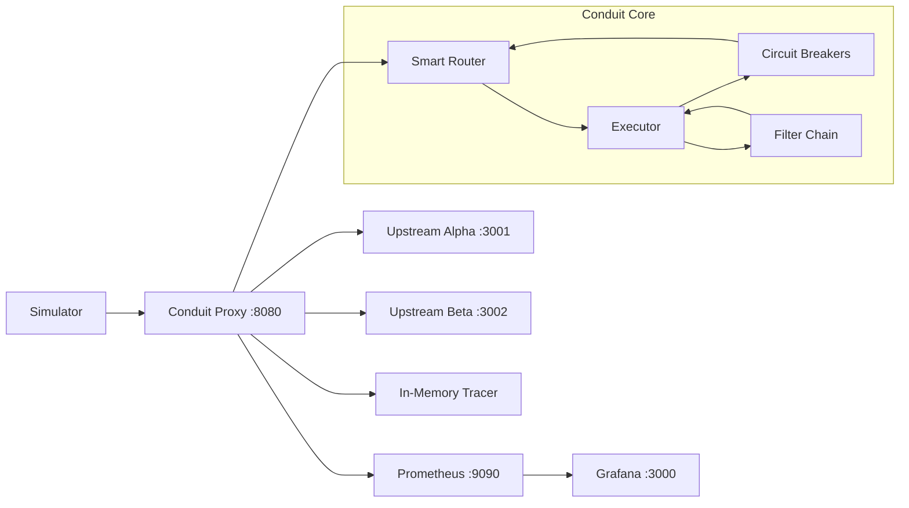

# Conduit


A minimal distributed systems lab for exploring adaptive routing, failure handling, and observability in Go.

Conduit is a self-healing HTTP proxy that routes traffic across multiple upstreams using latency-aware scoring, circuit breakers, and controlled exploration.

It simulates failures, latency spikes, and burst traffic while exposing Prometheus metrics and Grafana dashboards for real-time system visibility.

---

## Getting started

### One-command setup (recommended)

```bash
make up
```

### Local development (without Docker)

```bash
make dev
```

This starts the full stack:

- proxy (Conduit)
- upstream services (alpha, beta)
- simulator
- Prometheus
- Grafana

#### Access services

| Service  | URL |
| -------- | ------- |
| Proxy  | http://localhost:8080    |
| Upstream A | http://localhost:3001     |
| Upstream B    | http://localhost:3002    |
| Prometheus    | http://localhost:9090    |
| Grafana    | http://localhost:3000      |

Default Grafana login:

Username: admin  
Password: admin

---

## Why this exists

Modern distributed systems fail in non-obvious ways:

- latency increases before errors appear
- a “healthy” service can silently degrade
- naive load balancing amplifies failure domains
- reactive systems need feedback loops, not static rules

**Conduit is a controlled environment to observe, simulate, and reason about those behaviors.**

---

## Core ideas

- Adaptive routing based on EWMA latency + error rates
- Circuit breakers to isolate unhealthy upstreams
- Epsilon-based exploration to avoid local optima
- Replayable load simulation with burst and failure injection
- Full Prometheus-native observability (no custom metric pipelines or aggregations)

---

## System at a glance

Traffic flows through a decision layer that continuously balances:

- performance (latency)
- reliability (error rate)
- resilience (breaker state)
- exploration (randomized sampling)

Everything is observable in real time via Prometheus and Grafana.

---

## Observability

All metrics are exposed in Prometheus format at `/metrics`.

Grafana dashboards provide:
- Request rate per upstream
- Error rate per upstream
- Request latency (P95 / P99)
- System-wide traffic distribution

You can observe routing decisions shifting in real time as upstream latency or error rates change.

---

## Architecture



---

## Routing & scoring model

Upstream selection is based on a dynamic score computed from system signals:

- EWMA latency (recent performance signal)
- EWMA error rate (reliability signal)
- Circuit breaker state (hard exclusion)
- Epsilon exploration (random sampling to avoid local optima)

Conceptually:

```
score = 1000 - latency_penalty - error_penalty
```

Behavior:

- Fast + stable upstreams receive more traffic
- Degraded upstreams gradually lose traffic
- Failing upstreams are isolated automatically
- Occasional exploration ensures recovery detection

This creates a feedback loop where routing decisions continuously reinforce observed performance.

---

## Design philosophy

Conduit is intentionally minimal in features but strict in structure:

- Decisions are made at the edge (router)
- Execution is isolated (executor)
- Observability is first-class (Prometheus-native)
- Failure is a normal operating condition, not an exception

---

## License

MIT
